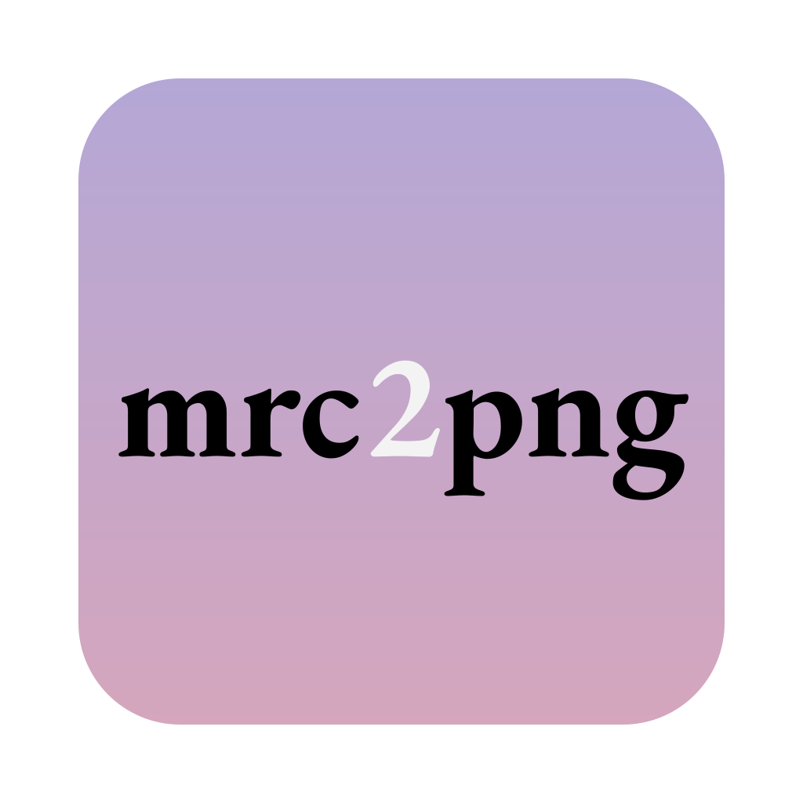
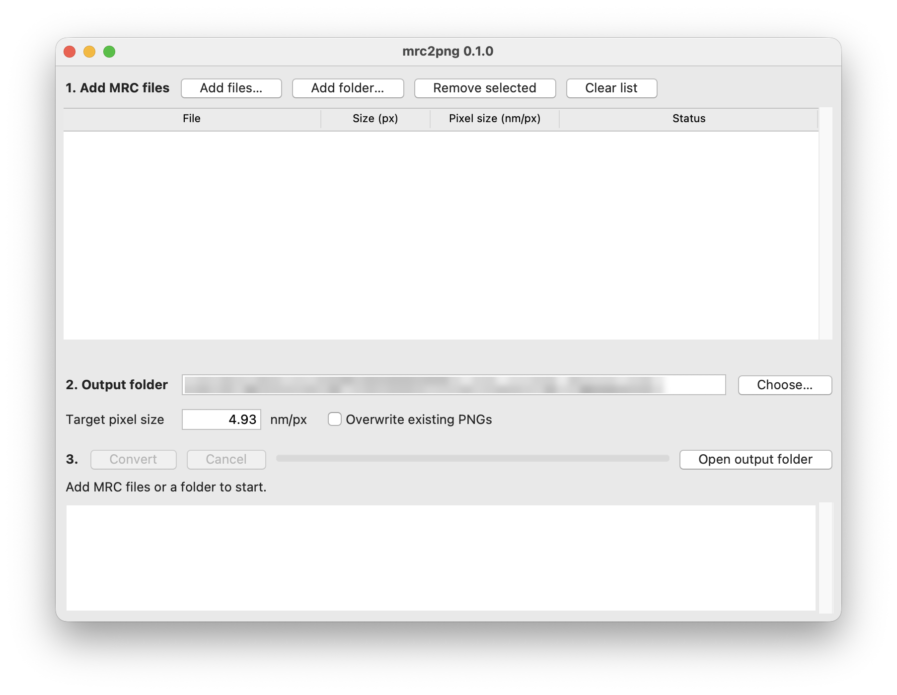

# mrc2png

  

A small desktop app that converts electron microscopy images (`.mrc`, `.mrcs`, `.rec`) into 8-bit PNGs resampled to **4.93 nm/px**.

  

## Download

**[Download the latest version](https://github.com/hermancollin/mrc2png/releases/latest)** and, under *Assets*, pick the file for your computer:

| Computer | File |
|---|---|
| Windows 10 or 11 (64-bit) | `mrc2png-windows-x64.exe` |
| Mac with Apple Silicon (M1 or newer), macOS 14 or later | `mrc2png-macos-arm64.zip` |

There's nothing else to install.

### Windows

1. Move `mrc2png-windows-x64.exe` somewhere convenient, such as your Desktop or Documents. This single file is the whole app.
2. Double-click it. It can take a few seconds to open.

The app isn't signed with a Microsoft certificate, so Windows warns you the first time:

- **Your browser** may say the file "isn't commonly downloaded". Choose **Keep** (in Edge: **…** → **Keep** → **Show more** → **Keep anyway**).
- **"Windows protected your PC"** (SmartScreen): click **More info**, then **Run anyway**. You only need to do this once.

If your antivirus deletes or blocks the file, contact the maintainer rather than turning the antivirus off.

### macOS

1. Double-click the zip to unpack it.
2. Drag **mrc2png.app** into your **Applications** folder.

The app isn't signed with an Apple developer certificate, so macOS blocks it the first time you open it. You only need to do this once.

- **macOS 15 (Sequoia) or later:**
  1. Double-click the app. macOS says it can't verify it; click **Done**.
  2. Open **System Settings → Privacy & Security** and scroll down.
  3. Next to the message about mrc2png, click **Open Anyway**, then confirm with your password.
- **macOS 14 (Sonoma):** right-click (or Control-click) the app, choose **Open**, then click **Open** again.

## How to use

Click for basic usage instructions

1. **Add files.** Click **Add files…** or **Add folder…**. Folders are searched, including subfolders.
2. **Choose an output folder.** Click **Choose…**. Leave the target pixel size at 4.93 nm/px unless you need another one.
3. **Click Convert.** You can keep working while it runs. **Cancel** stops after the file in progress. When it's done, click **Open output folder** to see the results.

Each image is saved as `<original name>_resized.png`. Files that already exist in the output folder are skipped, unless you tick **Overwrite existing PNGs**.

### What the status column means

| Status | Meaning |
|---|---|
| Ready | Will be converted. |
| Ready, will not be upsampled | The image is already coarser than the target. It's converted at its own resolution, not enlarged. |
| Needs pixel size (double-click) | The file has no pixel size. Double-click the row and enter it in nm/px. |
| Not supported | The file has several sections (a stack), can't be read, or uses an unsupported data type. It's skipped. |

Click a row to see the full file path and details below the list.

## What the conversion does

1. Reads the pixel size from the file header.
2. Shrinks the image to the target pixel size (bicubic interpolation). Images that are already coarser are never enlarged.
3. Stretches intensities to 0–255, then applies histogram equalization for contrast.
4. Saves an 8-bit grayscale PNG.

## Command line and development

mrc2png also has a command-line interface. See the [development guide](docs/DEVELOPMENT.md) for running from source, the CLI, tests, building the app and publishing releases.
